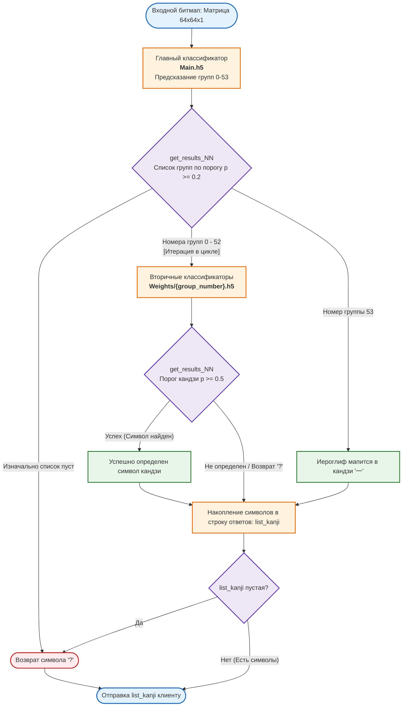

# KanjiApplication — Сервер распознавания кандзи и ИИ-бэкенд 🖌️

**KanjiApplication (Backend)** — это высокопроизводительный сетевой сокет-сервер на языке Python, реализующий инференс двухступенчатого каскада сверточных нейронных сетей (CNN) для распознавания рукописных японских иероглифов (кандзи) в реальном времени. Сервер принимает графическую информацию от мобильного Android-клиента, декодирует ее с помощью нативных алгоритмов C++ и возвращает предсказанный символ.

---

## 👥 Состав команды и роли
| Разработчик | Роль                                                     |
| :--- |:---------------------------------------------------------|
| **Максим Парфенов** | Backend Python Developer                           |

---

## 🛠️ Технический стек бэкенда

*   **Язык программирования:** Python 3.9+
*   **Глубокое обучение:** TensorFlow 2.x / Keras — архитектура и веса моделей сетей
*   **Вычисления и матрицы:** NumPy — манипуляция тензорами и подготовка данных к инференсу
*   **Системная интеграция:** Встроенная библиотека `ctypes` для вызова С-функций из динамических библиотек
*   **Сетевой слой:** Модуль `socket` (низкоуровневые блокирующие TCP/IP сокеты)

---

## 🧠 Архитектура каскадной системы нейросетей (CNN)

Для обеспечения высокой точности распознавания и преодоления проблемы схожести японских иероглифов бэкенд использует **двухуровневую каскадную систему классификаторов**:

1.  **Главный классификатор (`Main.h5`):** Принимает нормализованное изображение 64x64x1 и распределяет его по 54 предопределенным структурным группам (классам). Порог отсечения для группы составляет p ≥ 0.2.
2.  **Второстепенные классификаторы (`Weights/{group_number}.h5`):** Динамически подгружают веса для конкретной группы, предсказанной на первом этапе, и определяют точный кандзи внутри этой группы с порогом вероятности p ≥ 0.5.
3.  **Исключение (Группа 53):** Если главный классификатор определяет иероглиф в группу `53`, сервер автоматически мапит его в простейший кандзи «一» (одна черта), минуя инференс вторичных сетей.



### Топология сверточной сети (Keras Sequential)
Каждая нейросеть (как главная, так и 53 вторичных) имеет идентичную однородную структуру, оптимизированную под бинарные контурные изображения:

```python
model = keras.Sequential([
    Conv2D(32, (3,3), padding='same', activation='relu', input_shape=(64,64,1)),
    Conv2D(32, (3,3), padding='same', activation='relu'),
    MaxPooling2D((2,2), strides=2),
    Conv2D(64, (3,3), padding='same', activation='relu'),
    Conv2D(64, (3,3), padding='same', activation='relu'),
    MaxPooling2D((2,2), strides=2),
    Flatten(),
    Dense(512, activation='relu'),
    Dense(256, activation='relu'),
    Dense(count_classes, activation='softmax')
])
```

---

## 🌐 Сетевой протокол обмена и Сериализация

Обмен данными с Android-клиентом построен по проприетарному текстовому протоколу поверх TCP-сокетов для обеспечения независимости от endianness (порядка байт):

1.  **Формат фрейма:** Каждый пиксель вещественной матрицы (значение от `0.00` до `1.00`) кодируется в виде строки из 3 символов без разделителей: 1 символ — целая часть, 2 символа — дробная часть.
    *   *Пример:* Значение пикселя `0.98` преобразуется в строку `"098"`, а `0.00` — в `"000"`.
2.  **Длина данных:** Полный размер кодированного изображения 64x64 пикселя составляет ровно 12 288 символов.
3.  **Управление потоком:** Конец передачи фрейма строго маркируется символом `'w'`. Сервер считывает данные из буфера порциями, пока не обнаружит маркер завершения, после чего отсекает его и отправляет на нативное декодирование.

---

## 📐 Нативная интеграция C++ (`Decoding.so`)

Для ускорения обработки сетевого трафика и избавления Python от ресурсоемких циклов, декодирование текстовой строки в массив вещественных чисел вынесено в нативную библиотеку на C++.

Интеграция со стороны Python-сервера через `ctypes`:
```python
file = ctypes.CDLL('./Decoding.so')
file.Decoding.restype = ctypes.POINTER(ctypes.c_double * 64 * 64)
file.Decoding.argtypes = [ctypes.c_char_p]
```
После вызова `file.Decoding(encoded_image)` сервер получает указатель на сырой двумерный массив `double`, который затем преобразуется в NumPy-тензор формой `(1, 64, 64, 1)` для подачи на входной слой нейросети.

---

## 📂 Структура файлов сервера

Для успешного запуска скрипта серверная директория должна иметь следующий вид:
```filesystem
├── Weights/
│   ├── Main.h5               # Веса главной нейросети (54 класса)
│   ├── 0.h5                  # Веса вторичной нейросети для группы 0
│   ├── 1.h5                  # Веса вторичной нейросети для группы 1
│   └── ...                   # Веса для остальных групп (до 52.h5 включительно)
├── ALL_CLASS_KANJI.txt        # Текстовый файл с распределением иероглифов по группам
├── Decoding.so               # Скомпилированная С++ библиотека для декодирования строк
├── settings.json             # Конфигурационный файл сетевых настроек (host, port, name)
└── server.py                 # Главный исполняемый скрипт сервера
```

---

## 🔧 Запуск бэкенда

1.  Установите необходимые зависимости:
    ```bash
    pip install tensorflow numpy
    ```
3.  Запустите сервер:
    ```bash
    python server.py
    ```
    *Примечание:* При локальном тестировании совместно с Android Emulator, сервер должен слушать интерфейс `127.0.0.1` или `0.0.0.0`. Эмулятор автоматически перенаправит запросы сокетов приложения с адреса `10.0.2.2` на вашу машину.
